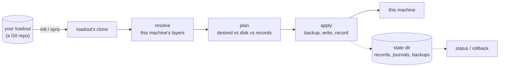

<div align="center">

# Loadout

**Declare your machine once, in a Git repository. Loadout brings every machine in line with it.**

User files, agent skills, global agent instructions, MCP servers, and programs,
on macOS, Linux, and Windows.

[Quickstart](#quickstart) · [Example](#a-complete-loadout) · [Commands](#commands) ·
[Agent guide](docs/agent-guide.md) · [Format](docs/loadout-format.md) · [Contributing](CONTRIBUTING.md)

</div>

> [!NOTE]
> **`v0.1.1` is the first stable release.** Loadout is early, and its scope is deliberately narrow:
> see [Status](#status).

## Why Loadout

- **One source of truth.** A loadout is a Git repository you own. Every machine reads it, and
  nothing writes back to it.
- **Built for coding agents.** Skills, `CLAUDE.md`/`AGENTS.md`-style instructions, and MCP servers
  reach exactly the agents you enable, at each agent's real path: Claude, Codex, Cursor, Grok,
  OpenCode, Pi, Muse, Antigravity, or one you declare.
- **Layered, not forked.** Global, then OS, then tags such as `work` or `laptop`, then one machine.
  A narrower layer adds, edits, replaces, or removes items from a broader one.
- **Safe by default.** `plan` shows every change first. `apply` backs up everything it overwrites,
  leaves a file you changed after it wrote it alone unless you pass `--force`, and `rollback`
  undoes a run.
- **No secrets in the repo.** A loadout names environment variables. Agents read the values when
  they start.

## How it works



Nothing is written until the whole plan builds. If the loadout is invalid or a template variable
is missing, the run ends with zero writes. Files are copied (or rendered), never linked. Each write
is atomic and journaled, and Loadout records the hash of everything it owns, so it can tell its
own changes from yours.

## Install

Each release has a prebuilt binary for six platforms. The install script picks the one for your OS
and CPU, checks its SHA-256, and installs it for your user. Loadout itself needs no admin rights.

The install scripts also set up the package managers your loadout's programs install with, so one
command takes a fresh machine to an applied loadout:

- **macOS:** Homebrew, through its own installer, which asks for your password once and brings `git`
  with the Command Line Tools. Pass `--no-homebrew` to skip it.
- **Windows:** winget (registering App Installer if needed), Scoop for your user, Chocolatey when
  run as an administrator, and `git` through Scoop. Pass `-NoPackageManagers` to skip them.
- **Linux:** Homebrew, through its own installer. `git`, `curl`, and a compiler (`build-essential`
  or your distribution's equivalent) must already be there. Pass `--no-homebrew` to skip it.

| OS | CPU | Script |
| --- | --- | --- |
| macOS | Apple Silicon (arm64) and Intel (x86_64) | `install.sh` |
| Linux, any distribution (static musl build) | x86_64 and aarch64 | `install.sh` |
| Windows | x64 and ARM64 | `install.ps1` |

**macOS and Linux**, from any POSIX shell. Needs `curl`, plus `git` and a compiler on Linux.

```sh
curl -fsSL https://raw.githubusercontent.com/dan-myles/loadout/main/scripts/release/install.sh | sh
```

This installs `loadout` to `~/.local/bin`. If that folder or Homebrew isn't on your `PATH`, the script
adds the line for it to your shell profile (`~/.zprofile` for zsh; `~/.bashrc` for bash on Linux,
`~/.bash_profile` on macOS; `~/.profile` otherwise), once. Pass `--no-modify-path` to have it print
the lines instead.

**Windows**, in PowerShell 5.1 or 7.

```powershell
& ([scriptblock]::Create((irm https://raw.githubusercontent.com/dan-myles/loadout/main/scripts/release/install.ps1)))
```

This installs `loadout.exe` and its background launcher, `loadout-background.exe`, to
`%LOCALAPPDATA%\Programs\loadout`. If that folder isn't on your `PATH`, the script prints the command
that adds it.

Then check the install:

```sh
loadout --version   # loadout 0.1.3
loadout doctor
```

To install and set up a machine in one step, pass your loadout's URL. The rest of the arguments go
to [`loadout init`](#quickstart).

```sh
curl -fsSL https://raw.githubusercontent.com/dan-myles/loadout/main/scripts/release/install.sh \
  | sh -s -- https://github.com/you/your-loadout.git --name laptop
```

```powershell
& ([scriptblock]::Create((irm https://raw.githubusercontent.com/dan-myles/loadout/main/scripts/release/install.ps1))) `
  -LoadoutUrl https://github.com/you/your-loadout.git -InitArgs '--name','desktop'
```

- **Pin a release** with `--version v0.1.1` (`sh -s -- --version v0.1.1`) or `-Version v0.1.1`.
  The default is the latest stable release.
- **Updates.** A binary installed this way is **managed**: `loadout update` (alias `upgrade`)
  replaces it with a newer stable release, after checking that release's SHA-256.
- **Existing installs.** The script replaces an existing binary only if this installer put it
  there. `install.sh` edits only your shell profile's `PATH` lines, and never with
  `--no-modify-path`; `install.ps1` never edits `PATH`.
- Every check the scripts make is in [docs/releasing.md](docs/releasing.md#installing-from-a-release).

**From source.** You need [rustup](https://rustup.rs), `git`, and the platform's C linker: Xcode
Command Line Tools on macOS, Visual Studio Build Tools with the MSVC C++ tools on Windows, or the
system `cc` and linker on Linux. The pinned toolchain in `rust-toolchain.toml` installs itself on
first build.

```sh
git clone https://github.com/dan-myles/loadout.git
cd loadout
cargo install --locked --path .
loadout --version   # loadout 0.1.3
loadout doctor
```

This puts `loadout` and its Windows background launcher, `loadout-background`, in
`~/.cargo/bin`. A source build is **unmanaged**: `loadout update` leaves it alone, so update it
with `git pull` and the same `cargo install` command.

## Quickstart

**1. Write a loadout.** Copy [`examples/starter/`](examples/starter) into a new folder, edit it,
and check it. Validate never touches the machine.

```sh
cp -r examples/starter ~/my-loadout && cd ~/my-loadout
git init -b main && git add -A && git commit -m "My loadout"
loadout validate .
```

**2. See what it would do.** `plan` reads the machine and changes nothing.

```sh
loadout plan --loadout .
```

Example output (the paths, the machine name, and which programs are missing or need elevation
depend on the machine):

```text
plan for ada-desktop from /home/ada/my-loadout
  create      /home/ada/.gitconfig  (files.gitconfig)
  create      /home/ada/.claude/skills/code-review  (skills.code-review for claude)
  create      /home/ada/.agents/skills/code-review  (skills.code-review for codex)
  create      /home/ada/.claude/CLAUDE.md  (instructions.global for claude)
  create      /home/ada/.codex/AGENTS.md  (instructions.global for codex)
  create      /home/ada/.claude.json#/mcpServers/github  (mcp.github for claude)
  create      /home/ada/.codex/config.toml#/mcp_servers/github  (mcp.github for codex)
  blocked     apt ripgrep  (programs.ripgrep): apt installs "ripgrep" system-wide, which needs `loadout apply --elevated`
7 of 8 actions would change this machine
```

`apt` installs system-wide, so that program waits for `loadout apply --elevated`, and plan exits 4
to say something is blocked. Until the machine is named, it goes by its hostname and gets only the
global and OS layers. Once `init --name work-laptop` saves its name, the `work` tag applies too.

**3. Push it, then set up each machine.** `init` clones the loadout, names the machine, applies,
and installs a background sync.

```sh
git remote add origin git@github.com:you/loadout.git && git push -u origin main
loadout init git@github.com:you/loadout.git --name work-laptop
```

**4. Keep it current.** Change the loadout repo, push, and every machine picks it up on its next
background sync, or now with:

```sh
loadout sync
loadout status
```

> [!TIP]
> Want to try it without touching your home? Set `LOADOUT_HOME` and `LOADOUT_STATE_DIR` to a
> temporary directory first. Every path Loadout writes then stays inside it.
> The [agent guide](docs/agent-guide.md#4-rehearse-in-a-sandbox) has a full rehearsal recipe.

## A complete loadout

```text
my-loadout/
├── loadout.toml                 the global layer, [loadout], and [machines]
├── tags/work.toml               what every machine tagged "work" changes
├── machines/work-laptop.toml    what one machine changes
├── files/gitconfig.tmpl         a templated user file
├── skills/code-review/SKILL.md  an agent skill
└── instructions/AGENTS.md       global agent instructions
```

```toml
# loadout.toml
[loadout]
version = 1

[machines.work-laptop]
tags = ["work"]

[variables]
name = "Ada Lovelace"
email = "ada@example.com"

[agents]
enabled = ["claude", "codex"]          # no agent gets anything unless it is listed

[files.gitconfig]
source = "files/gitconfig.tmpl"        # .tmpl: rendered with variables and machine facts
target = "~/.gitconfig"

[skills.code-review]
source = "skills/code-review"          # copied into each enabled agent's skills dir

[instructions.global]
source = "instructions/AGENTS.md"      # becomes ~/.claude/CLAUDE.md and ~/.codex/AGENTS.md

[mcp.github]
url = "https://api.githubcopilot.com/mcp/"
headers = { Authorization = { env = "GITHUB_TOKEN", prefix = "Bearer " } }

[programs.ripgrep]                     # first manager on PATH wins
brew = "ripgrep"
apt = "ripgrep"
winget = "BurntSushi.ripgrep.MSVC"
```

```toml
# tags/work.toml
[variables]
email = "ada@work.example"             # wins on work machines

[mcp.github]
agents = ["claude"]                    # only Claude gets this server at work
```

`files/gitconfig.tmpl`:

```jinja
[user]
	name = {{ name }}
	email = {{ email }}

[core]
	autocrlf = true

```

The whole example is in [`examples/starter/`](examples/starter). Every table and rule is in
[the loadout format](docs/loadout-format.md).

## Commands

| Command | Does | Changes the machine |
| --- | --- | --- |
| `loadout doctor [--json]` | checks that this machine can run loadout, and shows every agent's paths | no |
| `loadout validate [DIR] [--json]` | checks a loadout for every machine on every OS | no |
| `loadout plan [--loadout DIR] [--json]` | shows what apply would change here | no |
| `loadout status [--json]` | shows what loadout owns, drift, and every run | no |
| `loadout apply [--loadout DIR] [--force] [--elevated]` | brings this machine in line with the loadout | yes |
| `loadout init <URL> [--name NAME] [--no-service]` | clones, names the machine, applies, schedules sync | yes |
| `loadout sync [--loadout DIR]` | fetches and fast-forwards loadout's clone, then applies | yes |
| `loadout rollback [RUN]` | undoes the newest or the named run | yes |
| `loadout service install\|uninstall\|status` | manages the scheduled background sync | install and uninstall |
| `loadout update [--prerelease]` (alias `upgrade`) | updates the CLI binary itself; never syncs | the CLI only |

Every command shares one set of exit codes: **0** success, **1** runtime error, **2** usage error,
**3** the loadout is invalid (nothing written), and **4** the machine is unhealthy or blocked
(drift, a blocked action, a failed check).

## What goes where

| Agent | Skills | Global instructions | MCP servers |
| --- | :---: | :---: | :---: |
| Claude | ✓ | ✓ `CLAUDE.md` | ✓ |
| Codex | ✓ | ✓ `AGENTS.md` | ✓ |
| Cursor | ✓ | | ✓ |
| Grok | ✓ | ✓ | ✓ |
| OpenCode | ✓ | ✓ | ✓ |
| Pi | ✓ | ✓ | ✓ |
| Muse | macOS, Linux | | macOS, Linux |
| Antigravity | ✓ | ✓ | ✓, no env references |

An item an agent can't take shows up in the plan as `unsupported`, never as a silent skip.
`loadout doctor` prints each agent's exact paths on your machine. Programs install through
`brew`, `cask`, `apt`, `dnf`, `pacman`, `zypper`, `flatpak`, `snap`, `winget`, `scoop`, `choco`,
`cargo`, `uv`, `pipx`, `npm`, `pnpm`, `bun`, or `go`. Only missing programs are installed, and
system-wide managers need `--elevated`.

## Status

Loadout `0.1.3` is under active development, and its scope is deliberately narrow.

- **Tested natively** at specific commits, under the real schedulers:
  - macOS 27 on Apple Silicon: the full acceptance harness and a legacy launchd migration;
  - Windows 11 x64: a core, Unicode and long replay, plus MSVC builds;
  - Linux x86_64: composite VM acceptance.

  Self-update ran end to end against real GitHub releases on all three. Each platform's scope,
  results, and limits are in [docs/releasing.md](docs/releasing.md#validation-status). This is
  evidence for those commits and platforms, not a certification of every OS version, agent, or
  package manager.
- **Inferred:** Windows paths for Codex, Cursor, Pi, and Antigravity come from those agents'
  source, not from runs on Windows.
- **Not in v1:** upgrading or uninstalling programs, version pinning, secrets from keychains or
  password managers, and Muse on Windows.
- **CI is off.** The GitHub workflows exist but are disabled for now; checks run locally with
  [`scripts/ci/check.sh`](scripts/ci/check.sh).

## Documentation

| Read | When you want to |
| --- | --- |
| [Agent guide](docs/agent-guide.md) | drive Loadout from a coding agent: discovery, authoring, plan and apply, exit codes, recovery, scheduling, secrets, self-update |
| [The loadout format](docs/loadout-format.md) | write a loadout: every table, override, condition, template, and path rule |
| [`examples/starter/`](examples/starter) | start from a small loadout that validates |
| [CONTRIBUTING.md](CONTRIBUTING.md) | build, test, and change Loadout itself |
| [Architecture](docs/architecture.md) | read the full v1 contract every module codes against |
| [Releasing](docs/releasing.md) | cut a release, read the install scripts, check reproducibility |
| [Glossary](GLOSSARY.md) | learn the domain terms the code and docs use |
