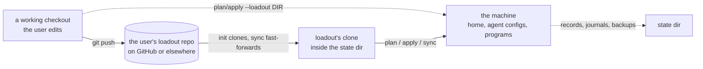

# Using Loadout from a coding agent

This guide is for an agent (or a careful human) driving the `loadout` CLI for a user: setting up
their machine, writing their loadout, applying it, and recovering when something goes wrong. Every
command, flag, exit code, and message here was checked against `loadout 0.1.5` and its source.

If you are changing Loadout's own code, read [CONTRIBUTING.md](../CONTRIBUTING.md) instead.

**On this page:** [Ground rules](#ground-rules) · [Discover](#1-discover-the-cli) ·
[Where things live](#2-where-things-live) · [Author](#3-author-a-loadout) ·
[Rehearse](#4-rehearse-in-a-sandbox) · [Validate](#5-validate) · [Plan](#6-plan) ·
[Apply](#7-apply) · [Set up a machine](#8-set-up-a-machine-with-init) · [Sync](#9-sync) ·
[Status and doctor](#10-status-and-doctor) · [Exit codes](#11-exit-codes) ·
[Recovery](#12-recovery) · [Scheduling](#13-scheduling) · [Noninteractive use](#14-noninteractive-use) ·
[Secrets](#15-secrets) · [Self-update](#16-self-update) · [Cheat sheet](#cheat-sheet)

## Ground rules

1. **Read before you write.** `doctor`, `validate`, `plan`, and `status` never change the machine.
   `apply`, `sync`, `init`, `rollback`, and `service install|uninstall` do. Before running one of
   those on the user's real home, show them the plan, unless they have already authorized that
   kind of run (for example "keep this machine synced", or a standing instruction). Within that
   authorization, don't ask again each run. Do ask before anything the plan shows they may not
   expect: a `replace` or `remove`, `--force` over their edits, or `--elevated`.
2. **Rehearse in a sandbox.** Set `LOADOUT_HOME` and `LOADOUT_STATE_DIR` to a temporary directory
   and every path Loadout itself touches stays inside it ([section 4](#4-rehearse-in-a-sandbox)).
3. **Branch on the exit code, then read the output.** 0, 1, 2, 3, and 4 mean different things
   ([section 11](#11-exit-codes)). Prefer `--json` where a command offers it.
4. **Never put a secret value in a loadout.** Reference an environment variable by name
   ([section 15](#15-secrets)).
5. **Loadout never writes to the loadout repository.** To change what a machine gets, edit the
   user's loadout repo, commit, push, then `loadout sync`.
6. **Capture output to a file, then read it.** Don't pipe a writing command into `head`: when the
   pipe closes early, the CLI panics on the broken pipe and exits 101, even though its work may
   have finished. Write the output fully (`> out.txt 2>&1`), then display it.

## 1. Discover the CLI

If `loadout` isn't on `PATH`, install the latest release for this OS and CPU (see the README's
[Install](../README.md#install) section for platforms and options). macOS and Linux:

```sh
curl -fsSL https://raw.githubusercontent.com/dan-myles/loadout/main/scripts/release/install.sh | sh
```

Windows PowerShell:

```powershell
& ([scriptblock]::Create((irm https://raw.githubusercontent.com/dan-myles/loadout/main/scripts/release/install.ps1)))
```

The binary goes to `~/.local/bin` (or `%LOCALAPPDATA%\Programs\loadout`). Before that, the install
scripts set up package managers so a loadout's programs can install, and `install.sh` makes `PATH`
stick in later shells:

- **macOS and Linux (`install.sh`):** runs Homebrew's installer when brew is missing. It asks for
  the user's password on the terminal (on macOS it also brings `git` with the Command Line Tools;
  on Linux `git` and `curl` must already be there, and the script stops if `git` is missing). It
  then adds Homebrew's `shellenv` line and `~/.local/bin` to the shell's login profile, once:
  `~/.zprofile` for zsh, `~/.bashrc` for bash on Linux, `~/.bash_profile` for bash on macOS,
  `~/.profile` otherwise. In `~/.bashrc` they go at the top, above Ubuntu's and Debian's early
  return for non-interactive shells, so `ssh host loadout …` and scripts see brew and npm. An
  install from before 0.1.4 appended them below that return; if `ssh host loadout plan` reports
  brew programs `unsupported`, move those two lines to the top of `~/.bashrc`, then run
  `loadout service install` again from a shell that has brew on `PATH` so the background sync
  records it.
- **Windows (`install.ps1`):** registers winget if it is missing, installs Scoop for the user,
  installs Chocolatey only when run as an administrator, and installs `git` through Scoop. It never
  edits `PATH`; it prints the command that adds its folder.

So the installer is no longer write-only-its-folder. For a discovery install that changes nothing
else, before you have asked the user, pass the opt-outs:

```sh
sh install.sh --no-homebrew --no-modify-path        # macOS and Linux
```

```powershell
& ([scriptblock]::Create((irm https://raw.githubusercontent.com/dan-myles/loadout/main/scripts/release/install.ps1))) -NoPackageManagers
```

With those, and without a loadout URL, the script writes only its folder (the binary, its install
record, and a lock file), applies nothing, and installs no service. If the folder isn't on `PATH`,
call loadout by its full path.

```sh
loadout --version          # loadout 0.1.5
loadout --help             # every command
loadout <command> --help   # its flags; `loadout service <sub> --help` for service
loadout doctor             # what this machine has, and where every agent's files go
```

| Command | What it does | Writes? | JSON |
| --- | --- | --- | --- |
| `doctor` | checks that this machine can run loadout | no | `--json` |
| `validate [DIR]` | checks a loadout for mistakes, for every machine and OS | no | `--json` |
| `plan [--loadout DIR]` | shows what apply would change here | no | `--json` |
| `status` | shows what loadout owns here, and the state of its runs | no | `--json` |
| `apply [--loadout DIR] [--force] [--elevated]` | brings this machine in line with the loadout | yes | |
| `init <URL> [--name NAME] [--no-service]` | clones the loadout, names the machine, applies, installs the sync service | yes | |
| `sync [--loadout DIR]` | fetches and fast-forwards loadout's clone, then applies it | yes | |
| `rollback [RUN]` | undoes a run: restores its backups, deletes what it created | yes | |
| `service install` | installs the scheduled background sync for this user | yes | |
| `service uninstall` | removes it | yes | |
| `service status` | shows whether it is installed and how its last run went | no | `--json` |
| `update [--prerelease]`, alias `upgrade` | updates the CLI binary itself | the CLI only | |

`sync --background [--service FILE]` is the command the scheduled job runs. You don't normally
run it by hand.

## 2. Where things live

Keep the user's repository, any working checkout, and loadout's own clone apart:



- **The loadout repository** is the user's. Loadout only reads it.
- **Loadout's clone** is `<state>/loadout`. `init` creates it, and `sync` fast-forwards it. `plan`
  and `apply` read it unless you pass `--loadout DIR`. Don't edit it: `sync` refuses to touch a
  clone with local changes.
- **The state dir** holds the machine name, ownership records, one journal and backup folder per
  run, the lock, and the background sync's records.

| OS | State dir |
| --- | --- |
| Linux | `$XDG_STATE_HOME/loadout`, or `~/.local/state/loadout` |
| macOS | `~/Library/Application Support/loadout` |
| Windows | `~\AppData\Local\loadout` |

```text
<state>/machine.toml      this machine's name and the loadout URL (written by init)
<state>/loadout/          loadout's own clone of the loadout
<state>/state.json        ownership: every target loadout wrote, with the hash of what it wrote
<state>/runs/<run-id>/    one journal.json and backups/ per apply
<state>/lock              held for one plan and apply
<state>/background/       the scheduled sync's last-run records and bounded log
```

`loadout doctor` prints the state dir, the config dir, the machine name, and the exact skills,
instructions, and MCP paths of every built-in agent on this machine.

Two environment variables change these paths. Both must be absolute paths.

| Variable | Effect |
| --- | --- |
| `LOADOUT_HOME` | replaces the home dir. Config, state, and every agent path derive from it, and the ambient `XDG_*` and agent dir variables (`CLAUDE_CONFIG_DIR`, `CODEX_HOME`, `GROK_HOME`, `PI_CODING_AGENT_DIR`, `GEMINI_HOME`) are ignored. Package managers, the scheduler, and self-update are refused, since they act on the real user. |
| `LOADOUT_STATE_DIR` | replaces the state dir, with or without `LOADOUT_HOME` |

Without `LOADOUT_HOME`, an absolute `XDG_CONFIG_HOME`, `XDG_STATE_HOME`, and the agent dir
variables above are honoured.

## 3. Author a loadout

A loadout is a Git repository whose root holds `loadout.toml`. Start from
[`examples/starter/`](../examples/starter):

```text
my-loadout/
├── loadout.toml                 global layer, [loadout], [machines]
├── tags/work.toml               what machines tagged "work" change
├── machines/work-laptop.toml    what one machine changes
├── files/gitconfig.tmpl         a templated user file
├── skills/code-review/SKILL.md  a skill
└── instructions/AGENTS.md       global agent instructions
```

```toml
# loadout.toml
[loadout]
version = 1

[machines.work-laptop]
tags = ["work"]

[variables]
name = "Ada Lovelace"
email = "ada@example.com"

[agents]
enabled = ["claude", "codex"]

[files.gitconfig]
source = "files/gitconfig.tmpl"
target = "~/.gitconfig"

[skills.code-review]
source = "skills/code-review"

[instructions.global]
source = "instructions/AGENTS.md"

[mcp.github]
url = "https://api.githubcopilot.com/mcp/"
headers = { Authorization = { env = "GITHUB_TOKEN", prefix = "Bearer " } }

[programs.ripgrep]
brew = "ripgrep"
apt = "ripgrep"
winget = "BurntSushi.ripgrep.MSVC"
```

To create a user's personal loadout:

1. Copy `examples/starter/` into a new folder, then `git init` it.
2. Replace the variables and add the user's items. Ask which agents they use, and list exactly
   those in `[agents] enabled`: the default is none, so nothing reaches an agent they didn't name.
3. List each of their machines under `[machines]` with its tags. Add a `machines/<name>.toml` only
   for what differs on one machine.
4. Run `loadout validate .` until it exits 0, and fix any warnings that matter.
5. Commit, and push to a repository the user owns. A private repository works through their
   existing Git credentials or SSH keys. Loadout stores no token.

Rules worth knowing before you write:

- An unknown key is an error, so typos fail loudly.
- Ids are lowercase `[a-z0-9][a-z0-9_-]*`.
- Targets start with `~/` or `{config}/`. Sources are relative paths inside the loadout.
- Only a user file whose source ends in `.tmpl` is rendered. Templates are strict: a missing
  variable is an error.
- A narrower layer edits an inherited item by naming its id: fields merge, `remove = true` drops
  it, and `replace = true` swaps it whole.
- A program installs only through a manager listed in its table that is on `PATH` when apply plans.
  Casks are macOS-only, so a cask-only program is `unsupported` on Linux and Windows. Give a program
  an `apt`, `dnf`, or `winget` id too if those machines need it without Homebrew.
- A manager installed by the same run isn't seen until the next one: with `node` from brew and
  `t3` from npm, `t3` is `unsupported` on the first apply and installs on the next sync.
- A brew or cask id from a third-party tap (`oven-sh/bun/bun`) trusts that tap. Naming it is the
  user's trust decision, so don't add a tap the user didn't ask for.
- A program that ships only as GitHub release assets (an AppImage, a `.tar.gz` CLI, a macOS app
  `.zip`) uses `github = { repo, asset = { <os>-<arch> = "<pattern>" }, tag?, prerelease?, bin?, app? }`.
  It is tried after every manager and installs per user. Follow a channel with `tag` (for example
  `"v*-nightly.*"` with `prerelease = true`); loadout installs once and the program updates itself.
  Naming the repository is a trust decision like a tap.
- An `apt` package that isn't in the distro's own repositories names its repository with
  `apt-repo = { url = "https://…", key = "https://…" }` (optional `suite`, default `{codename}`,
  and `components`, default `["main"]`). It is a trust decision like a tap: add one only for a
  repository the user asked for, and take the URL and key from the vendor's install docs.

[The loadout format](loadout-format.md) has every table, override rule, condition, path rule, and
agent and manager table.

## 4. Rehearse in a sandbox

Run the real commands against a throwaway home before touching the user's. Under `LOADOUT_HOME`,
every file, skill, instruction, MCP config, and state file Loadout writes lands in the sandbox.
Programs are never installed there.

```sh
SANDBOX="$(mktemp -d)"
export LOADOUT_HOME="$SANDBOX/home" LOADOUT_STATE_DIR="$SANDBOX/state"

cd my-loadout
loadout validate .
loadout init "file://$PWD" --name work-laptop --no-service > "$SANDBOX/init.log" 2>&1
loadout plan --loadout . --json > "$SANDBOX/plan.json"
loadout apply --loadout . > "$SANDBOX/apply.log" 2>&1
loadout status --json > "$SANDBOX/status.json"

# read the logs and JSON, then clean up
unset LOADOUT_HOME LOADOUT_STATE_DIR
rm -rf "$SANDBOX"
```

- `init "file://$PWD"` clones the committed `HEAD`, so the repo needs at least one commit. It also
  saves the machine name, so later `plan` and `apply` resolve that machine's tags. `--loadout .`
  then uses the working tree, uncommitted edits included.
- In a sandbox, any `[programs]` item is `blocked` with "programs are not installed under
  LOADOUT_HOME isolation", which makes `init`, `plan`, and `apply` exit 4. That is expected. Any
  other block, and any other nonzero exit, is a real finding.
- Git still reads the user's real Git config and credentials when it clones. It writes only to the
  sandbox state dir.

## 5. Validate

```sh
loadout validate path/to/loadout          # default DIR: .
loadout validate path/to/loadout --json
```

Validate never touches the machine. It checks the schema, then resolves every listed machine on
macOS, Linux, and Windows, on both CPU architectures, and checks every template's syntax. Each
diagnostic names its file and key. One that depends on the machine also names the machines and
OSes it affects, such as `(on work-laptop: windows)`.

```json
{
  "valid": false,
  "root": "tests/foundation/invalid",
  "layers": [],
  "items": 0,
  "diagnostics": [
    {
      "severity": "error",
      "file": "loadout.toml",
      "key": "update.interval_minutes",
      "message": "must be at least 15"
    }
  ]
}
```

Exit 0 when valid (warnings allowed), 3 when invalid. Fix the errors, rerun, repeat.

## 6. Plan

```sh
loadout plan --json                       # from loadout's clone
loadout plan --loadout path/to/loadout --json
```

Plan builds exactly what apply would do, for this machine, and writes nothing: no state dir, no
lock. It renders every template first, so a missing variable is exit 3 before any action exists.

Each action has an `item` (`kind`, `id`, `agent`), a `target` (`path`, `entry` for one MCP key in a
shared file, `program`, or `none`), a `change`, and the `prior` it observed. `blocked` and
`unsupported` actions carry a `reason`. File content is never printed.

| `change` | Meaning | What to do |
| --- | --- | --- |
| `create` | the target doesn't exist yet | nothing |
| `update` | an owned target differs from the loadout | nothing |
| `unchanged` | an owned target already matches | nothing |
| `adopt` | an unowned target already equals the loadout; it will be recorded as owned | nothing |
| `replace` | an unowned file is in the way; apply backs it up, then overwrites it | **tell the user**: their file is replaced |
| `drifted` | an owned target was changed outside loadout | ask: keep their edit, or `apply --force` |
| `remove` | an owned target the loadout no longer declares; apply backs it up, then deletes it | confirm it was meant |
| `install` | a missing program will be installed | nothing |
| `unsupported` | this agent or machine can't take the item; it is skipped | usually fine; read the reason |
| `blocked` | needs `--elevated`, a same-named MCP server loadout doesn't own exists, or a fact of the machine stops it | read the reason |

Plan exits 0 when nothing is blocked or drifted, 3 when the loadout is invalid, and 4 when
anything is blocked or drifted. When it can't plan at all, `--json` prints a refusal instead of
actions: `{"error": "invalid", "diagnostics": [...]}` (exit 3), or
`{"error": "blocked", "message": "..."}` (exit 4), for example after an interrupted run.

## 7. Apply

```sh
loadout apply                             # from loadout's clone
loadout apply --loadout path/to/loadout   # from any checkout, as it is
loadout apply --force                     # also overwrite drifted targets, after a backup
loadout apply --elevated                  # also install system-wide programs via sudo or UAC
```

What apply guarantees:

- **Nothing is written if the loadout is invalid.** It plans first, then takes the lock and plans
  again.
- **Copy, never link.** Files, skills, and instructions are copied (templates rendered) on every
  OS.
- **Every overwrite is backed up** into the run's folder before the target changes, and each write
  is atomic: a temporary file, `fsync`, then a rename.
- **A target that changed after the plan is never overwritten.** Each write checks the target
  again first.
- **Drift is left alone** without `--force`: the action is `skipped`, and the exit code is 4.
- **Removal is cautious.** An owned target the loadout dropped is backed up and removed. One that
  drifted is released from ownership and left in place. Programs are never uninstalled.
- **MCP servers are per key.** Loadout edits only the keys it owns in an agent's shared config, and
  never overwrites a same-named server it didn't write.
- **Programs install only when missing**, through the manager chosen at plan time. For a
  third-party tap package, apply first runs `brew tap user/repo` and `brew trust --tap user/repo`
  (Homebrew 7 refuses untrusted taps; an older brew without `trust` is accepted), then installs.
  Plan never taps or trusts: it reads the package's folder under `Cellar` or `Caskroom` instead of
  asking brew, so it stays read-only. For an apt package with an `apt-repo`, apply (elevated, like
  any apt install) first downloads the key to `/etc/apt/keyrings/loadout-<id>.{gpg,asc}`, writes
  `/etc/apt/sources.list.d/loadout-<id>.list`, and runs `apt-get update` for that list only. Plan
  shows it as an ordinary `install`; a machine that already has the package is never touched,
  and a repository another source already names (say, from the vendor's install script) is left
  as it is.
  A failure here is `programs.<id>: cannot add its apt repository: …` or the failed command.
- **GitHub releases install per user, no `--elevated`.** Plan shows `install github owner/repo:<place>`
  and never touches the network: it checks only the install path. Apply lists the repository's
  newest releases (unauthenticated GitHub API), downloads the matching asset, and refuses it
  unless its sha256 matches GitHub's digest. Failures read `programs.<id>: cannot install its
  github release: …`. Under `LOADOUT_HOME` it is `blocked` like every program; to rehearse a real
  install, point `HOME` and `LOADOUT_STATE_DIR` at a temporary directory instead.

Its output is one line per action, then the run id. For example:

```text
apply for work-laptop from /home/ada/.local/state/loadout/loadout
  done              /home/ada/.gitconfig  (files.gitconfig)
  done              /home/ada/.claude/skills/code-review  (skills.code-review for claude)
  done              /home/ada/.claude.json#/mcpServers/github  (mcp.github for claude)
  skipped           /home/ada/.zshrc  (files.zshrc): it changed since loadout wrote it; `loadout apply --force` overwrites it after a backup
run 20261027T150910.766110612Z; `loadout rollback 20261027T150910.766110612Z` undoes it
```

Outcomes are `done`, `adopted`, `removed`, `released`, `unchanged`, `installed`,
`already installed`, `unsupported`, `skipped`, `blocked`, `mismatch` (the target didn't read back as
written), and `failed`. Apply exits 1 when an action failed, 3 when the loadout is invalid, and 4
when anything was blocked, skipped, or mismatched. `unsupported` alone still exits 0.

`--elevated` may make `sudo` ask for a password on the terminal, or a Windows installer raise a UAC
prompt. Don't pass it unattended.

## 8. Set up a machine with init

On a fresh machine, the install script does everything in one command: package managers, the CLI,
the profile `PATH` lines, then `init`. The repository needs no credentials when it is public;
loadout only reads it.

```sh
curl -fsSL -o install.sh https://raw.githubusercontent.com/dan-myles/loadout/main/scripts/release/install.sh
sh install.sh https://github.com/ada/loadout.git --name work-laptop
```

The `curl` line only downloads the script and prints nothing; the `sh` line runs it. On Linux run
`sudo apt install -y git curl` (or the distribution's equivalent) first. With loadout already
installed:

```sh
loadout init https://github.com/ada/loadout.git --name work-laptop
loadout init git@github.com:ada/loadout.git --name work-laptop --no-service
```

`init` clones the loadout into `<state>/loadout`, saves the machine name, applies, and installs the
background sync service unless `--no-service` is passed or the loadout sets `[update] auto = false`.

- **Pass `--name`.** Without it, init asks in a terminal and otherwise takes the hostname-derived
  name. A name the loadout doesn't list gets the global and OS layers only, and init says so.
- **A saved name never changes.** A different `--name` on a machine that already has one is
  refused.
- **Run it once.** If `<state>/loadout` exists, init refuses and points at `loadout sync`.
- **No credentials in the URL.** A URL with a password is refused before anything is written. Use
  the user's Git credential helper or SSH key.
- Exits: 0 on success, 3 when the loadout is invalid (the service is then not installed), 4 when the
  apply or the service install was unhealthy, 1 on an error such as a failed clone.
- **Brew must be on `PATH` when init runs.** The install script arranges that. An init run by hand
  from a shell without Homebrew's `shellenv` line reports every brew program `unsupported`, and the
  service records that same `PATH`. Fix the profile, open a new shell, then run
  `loadout service install` so the service records the new `PATH`.
- **The service syncs as soon as it is installed.** On Linux its systemd timer fires right away,
  and a sync applies. Tell the user before running `loadout service install` if they asked for
  nothing to be applied.

## 9. Sync

```sh
loadout sync                                # fetch, fast-forward, apply
loadout sync --loadout path/to/checkout     # apply that checkout as it is; nothing is fetched
```

`sync` takes the lock, refuses if the newest run didn't finish, fetches and fast-forwards loadout's
clone, then applies it under the same lock. It never passes `--force` or `--elevated`, so drift and
system-wide programs are reported, not handled. Sync never updates the CLI.

It applies nothing and exits 4 when the clone can't be fast-forwarded. It leaves the clone's branch
and working tree as they were, so nothing is lost yet.

| Reason printed | What it means |
| --- | --- |
| the clone has local changes | someone edited or added files in the clone |
| a merge, rebase, cherry-pick, revert, or bisect is unfinished in the clone | a Git operation was started there and not finished |
| the clone has no branch checked out | the clone is on a detached `HEAD` |
| the clone's branch doesn't track a branch of origin | the branch has no upstream |
| the clone has commits the remote doesn't have, and loadout never pushes | someone committed in the clone |
| the clone and the remote have both moved on, and loadout only fast-forwards | someone committed in the clone, and the remote has new commits too |

The clone should only ever follow the remote, but whatever is in it may be the user's work. Before
you discard, abort, or reset anything:

1. **Inspect it.** In `<state>/loadout`, run `git status`, `git stash list`, and
   `git log --oneline @{u}..HEAD` (or `git log --oneline -10` with no upstream). Find out what is
   there and who made it.
2. **Preserve it.** Save the user's edits and commits outside the clone first: push them to a
   branch of their loadout repo, or export them with `git format-patch` or `git diff > file`, and
   copy out any untracked files `git status` lists, since `git diff` leaves those out.
   Changes they want kept belong in their own loadout repo, where `sync` will bring them back.
3. **Confirm the removal.** Unless the user has already authorized discarding the clone's local
   state, show them what will be lost and get their yes.
4. **Only then restore the clone**: finish or abort the Git operation, check out the tracking
   branch, set its upstream, or reset the branch to its upstream. Then run `loadout sync` again.

Never abort someone's merge or rebase, discard their edits, or reset their commits blindly.

With `--loadout DIR`, sync prints `not fetched: DIR is not loadout's own clone, so it is applied as
it is` and never fetches, merges, or changes that checkout.

## 10. Status and doctor

```sh
loadout status --json
loadout doctor --json
loadout service status --json
```

**`status`** lists every ownership record with its health, every run, and the last background run.
It never writes.

- Record `health`: `ok`, `drifted` (changed outside loadout), `missing` (deleted outside loadout),
  or `unchecked` with a `detail`.
- Run `status`: `finished`, `rolled-back`, `interrupted`, `in-progress` (another process holds the
  lock), or `null` with an `error` when its journal can't be read.
- Top-level `healthy` is `false`, and the exit code is 4, when a record isn't `ok`, a run is
  interrupted or unreadable, or the last background run was blocked, invalid, failed, timed out, or
  uncontained.

**`doctor`** checks the machine: version, platform, home, config and state dirs, machine name,
`git`, the package managers on `PATH`, every agent's paths, elevation, loadout's clone, the
service, the last background run, and how the CLI was installed. Each check has a `status` of
`pass`, `info`, `warn`, or `fail`. Doctor exits 4 when any check fails, and never writes. `git` is
the one prerequisite. The CLI never installs it, and doctor names the install command for the OS;
the install scripts set it up on macOS and Windows along with the package managers.

## 11. Exit codes

Every command uses the same codes.

| Code | Meaning | Typical next step |
| --- | --- | --- |
| `0` | success | none |
| `1` | runtime error: I/O, git, a subprocess, another run holding the lock, a failed action. The error and its causes are on stderr | read stderr; retry once the cause is fixed |
| `2` | usage error: a bad flag or argument | check `--help` |
| `3` | the loadout is invalid. Nothing was written | `loadout validate`, fix, retry |
| `4` | the machine is unhealthy or blocked: drift, a blocked action, a failed doctor check, a sync that can't fast-forward, a rollback that later changes block, or `update` that can't update this binary | read the output; it names each problem |

A panic exits `101`. The one known cause is a closed stdout pipe (see [ground rule 6](#ground-rules)).

```sh
loadout plan --json > plan.json; code=$?
case $code in
  0) echo "clean plan" ;;
  3) echo "invalid loadout: run loadout validate" ;;
  4) echo "something is blocked or drifted: read plan.json" ;;
  *) echo "error $code" ;;
esac
```

## 12. Recovery

**Drift** (status shows `drifted`, apply prints `skipped`): someone edited a file loadout owns.
Ask the user. To keep their edit, copy it into the loadout repo and sync. To discard it,
`loadout apply --force` backs it up and overwrites it.

**Undo a run:**

```sh
loadout status                 # lists runs, newest last
loadout rollback               # undoes the newest run
loadout rollback 20261027T150918.505083678Z
```

Rollback restores each backup with its recorded modes, deletes the files the run created, removes
the folders it made once they are empty, and puts the ownership records back. It checks everything
first. If any target holds neither what the run wrote nor what was there before, because a later
run or the user changed it, rollback restores nothing and exits 4. Roll back newer runs first, or
resolve the change by hand. Rolling back a run that is already rolled back is an error (exit 1).

**An interrupted run** (status shows `interrupted`) blocks every new plan, apply, and sync with
`run <id> didn't finish; ... run loadout rollback to undo it`. If no other loadout process is
running, `loadout rollback` undoes the interrupted run the same way. Running it again after a
partial rollback skips what is already restored.

**Another run holds the lock** (`another loadout run holds <state>/lock; wait for it to finish and
try again`, exit 1): the background sync or another apply is running. Wait, then retry. `status`
shows it as `in-progress`.

**Programs** are never rolled back or uninstalled.

## 13. Scheduling

```sh
loadout service install         # at the loadout's [update] interval_minutes
loadout service status --json
loadout service uninstall
```

The background sync runs `loadout sync --background` every `interval_minutes` (default 60, minimum
15). It is supervised and time-bounded (about an hour at most), never prompts, never forces, and
never elevates. Drift and blocked actions are recorded for `loadout status` and
`loadout service status`.

| OS | Job |
| --- | --- |
| macOS | launchd agent `~/Library/LaunchAgents/dev.loadout.update.plist` |
| Linux | systemd user timer `loadout-update.timer` with `loadout-update.service`, under `{config}/systemd/user/` |
| Windows | Scheduled Task `\Loadout Update` for the current user, least privilege, no admin |

- `service install` reads the interval from loadout's clone, so run `init` (or `sync`) first. It
  exits 4 when the loadout sets `[update] auto = false`, on Linux without a systemd user session,
  and under `LOADOUT_HOME`.
- To change the interval, change `[update] interval_minutes` in the loadout, sync, and run
  `service install` again: it replaces the job.
- Setting `[update] auto = false` in the loadout stops scheduled runs from applying anything,
  even before the job is uninstalled.
- Jobs registered by older versions ran `loadout update --background`. That form still runs the
  same sync, never a CLI update, and prints how to re-register. `doctor` and `service status` flag
  it; `loadout service install` rewrites it in the current form.

## 14. Noninteractive use

Loadout is built to run without a person at the keyboard.

- No command prompts, with two exceptions. `init` asks for a machine name only when both stdin and
  stdout are a terminal, so pass `--name`. `apply --elevated` may hit a `sudo` password prompt or a
  UAC dialog, so don't pass it unattended.
- Package managers run with a null stdin and `LC_ALL=C`, and with their own noninteractive flags
  where they have one, such as `apt-get install -y`.
- `--json` is available on `doctor`, `validate`, `plan`, `status`, and `service status`. `apply`,
  `sync`, `init`, and `rollback` print one line per action. Their exit code is the contract.
- Diagnostics go to stdout. A runtime error goes to stderr as `error: <message>` with exit 1.
- When stderr is a terminal, `apply`, `sync`, and `init` show a spinner there naming what they
  wait on: planning, each program install, and `init`'s service install. Each erases itself
  when its step ends. An install that may ask for a `sudo` password gets a plain line instead.
  Piped or redirected stderr gets none of this, so captured output is unchanged.
- A writing command takes the state lock without waiting. A second one exits 1 at once rather than
  queueing.

## 15. Secrets

A loadout holds the *name* of an environment variable, never its value:

```toml
[mcp.github]
url = "https://api.githubcopilot.com/mcp/"
headers = { Authorization = { env = "GITHUB_TOKEN", prefix = "Bearer " } }
```

Loadout writes the reference in each agent's own syntax, so the agent reads `GITHUB_TOKEN` from
its environment when it starts. The value never reaches a config, a plan, a journal, a backup, or
any output. Make sure the variable is set where the agent runs. Loadout doesn't set it.

- If a user hands you a token, put it in their shell or secret manager, never in the loadout.
  Validate warns about plaintext values that look like credentials.
- Loadout never reads, copies, or writes agent auth stores or OAuth tokens.
- Repository access uses the user's Git credentials or SSH keys. A clone URL carrying a password
  is refused.

## 16. Self-update

```sh
loadout update                  # same as: loadout upgrade
loadout update --prerelease     # also consider test prereleases
```

`update` replaces the CLI binary with a strictly newer release, after checking its SHA-256. It only
updates the CLI: it never fetches or applies the loadout. Likewise, `sync`, `init`, and the
scheduled job never update the CLI.

- It replaces only a **managed** binary: one that `install.sh` or `install.ps1` installed, with a
  matching install record. A binary built from source, installed with `cargo install`, or copied by
  hand is left alone: `update` prints `cli: not updated: <reason>` and exits 4.
  `loadout doctor`'s `cli install` check says which case applies.
- Without `--prerelease`, only stable releases count. The first is `v0.1.1`. A source build stops
  earlier, at the unmanaged check above.
- The `v0.1.1-test.N` prereleases are test builds, labelled not for use. Don't move a user onto
  one unless they ask for a test build. `v0.1.1` ranks above all of them, so a managed test build
  that runs `update` moves onto `v0.1.1`.
- Exits: 0 when updated, already up to date, or nothing is published. 4 when this binary can't be
  updated (unmanaged, under `LOADOUT_HOME`, or another install holds the lock). 1 on any other
  error, which is never reported as up to date.

## Cheat sheet

```sh
# discover
loadout doctor --json
loadout validate . --json

# rehearse, then apply for real
loadout plan --loadout . --json > plan.json
loadout apply --loadout .

# a new machine (package managers, the CLI, PATH, then init)
curl -fsSL -o install.sh https://raw.githubusercontent.com/dan-myles/loadout/main/scripts/release/install.sh
sh install.sh https://github.com/ada/loadout.git --name work-laptop

# install only the CLI, touching nothing else
sh install.sh --no-homebrew --no-modify-path

# keep it current
loadout sync
loadout service install
loadout status --json

# undo
loadout rollback
```
